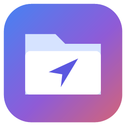
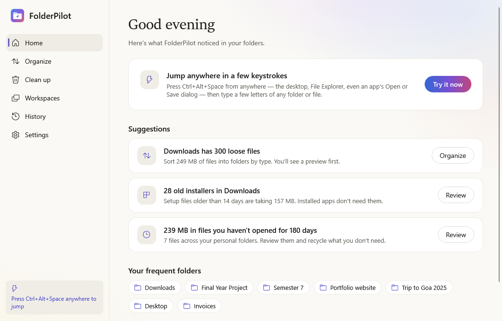
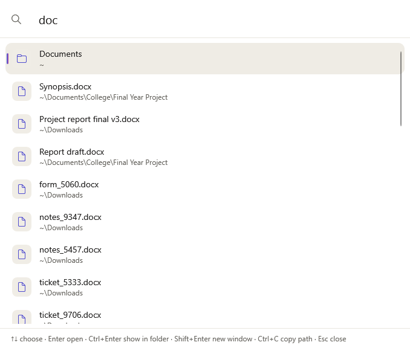
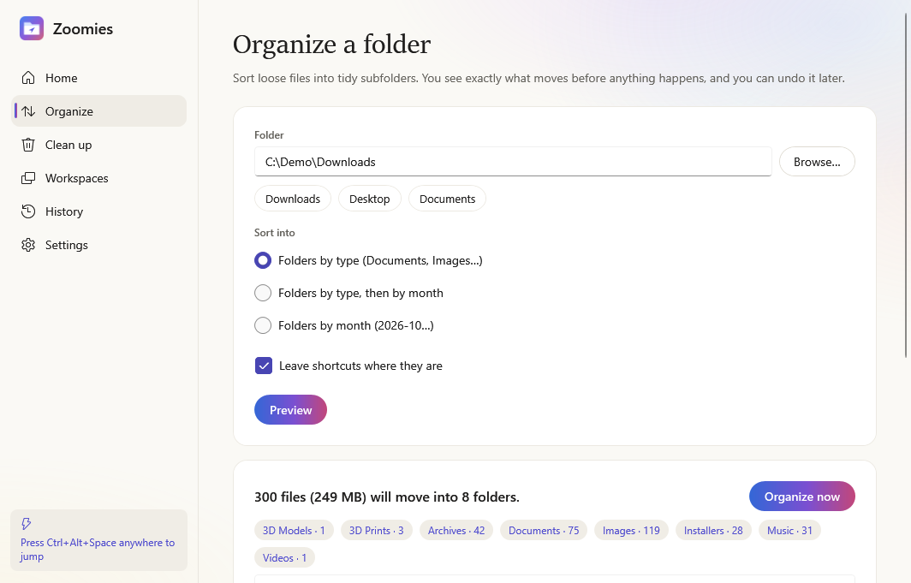
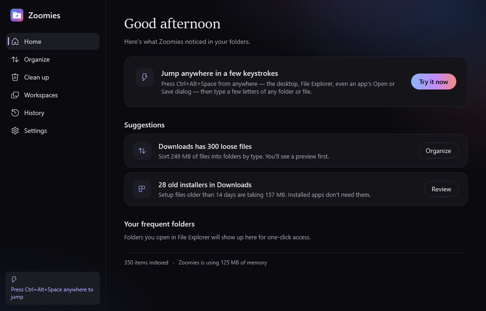

<div align="center">



# Zoomies

**Get to any file in a flash. Keep your PC tidy. Undo anything.**

A small, free companion for Windows File Explorer: jump to any folder or file in a few keystrokes,
sort messy folders in one click, and clear out what you don't use — all on your PC, with undo for everything.

[](https://github.com/lakshmang007/zoomies/releases/latest/download/Zoomies-win-Setup.exe)

[](https://github.com/lakshmang007/zoomies/releases/latest)
[](https://github.com/lakshmang007/zoomies/releases)
[](https://github.com/lakshmang007/zoomies/actions/workflows/ci.yml)
[](LICENSE)



</div>

## What it does

| | |
|---|---|
| ⚡ **Quick Jump** | Press **Ctrl+Alt+Space** anywhere — the desktop, File Explorer, even an app's Open or Save dialog — type a few letters, and you're there. It learns the folders you use most. |
| 🗂️ **Organize** | Turns a messy folder like Downloads into tidy subfolders by type or by month. You see exactly what will move first. Search a type such as `stl` and name its folder yourself (`3D Prints`) — Zoomies remembers it. |
| 🧹 **Clean up** | Finds files you haven't opened in months, duplicate copies, large files, old installers and empty folders. Everything goes to the Recycle Bin, never straight to deletion. |
| ↩️ **Undo anything** | Every move and clean-up is in History. One click puts it all back. |
| 🪟 **Workspaces** | Save the File Explorer windows you have open and reopen them all at once — per project, class or client. |
| 🤖 **Auto-tidy** | Optionally sorts finished downloads into folders every 15 minutes. |

<div align="center">


<br/>

</div>

## Why people use it

- **Safe.** A preview before anything moves, the Recycle Bin instead of permanent deletes, and undo for every action.
- **Private.** No account, no cloud, no tracking. Your files and file names never leave your PC.
  The only thing Zoomies fetches is the list of new versions from this repository (you can turn that off in Settings).
- **Light.** A native Windows app, not a browser in disguise. It idles in the tray and gives memory back to Windows.
- **Free and open source** under the MIT license.

## Install

1. Download **[Zoomies-win-Setup.exe](https://github.com/lakshmang007/zoomies/releases/latest/download/Zoomies-win-Setup.exe)** and run it.
   It installs for your account only — no admin rights needed — and opens Zoomies when it's done.
2. Press **Ctrl+Alt+Space** and start typing. If another app already uses that shortcut, Zoomies picks a free one
   and tells you which.

Zoomies starts with Windows and updates itself quietly. To remove it, use **Settings → Apps → Installed apps**.
Your settings and undo history stay in `%APPDATA%\Zoomies` in case you reinstall; delete that folder to remove them too.

> **"Windows protected your PC"?** The installer isn't code-signed yet, so SmartScreen may warn about it.
> Choose **More info → Run anyway**. You can check the code and the build in this repository: every release is built
> from the public source by GitHub Actions.

Prefer not to install? Download **Zoomies-win-Portable.zip** from the [latest release](https://github.com/lakshmang007/zoomies/releases/latest), unzip it and run `Zoomies.exe`.

**Requires** 64-bit (x64) Windows 10 or 11. On ARM PCs it runs through Windows 11's built-in emulation; Windows 10 on
ARM isn't supported.

## Quick Jump keys

| Key | What it does |
|---|---|
| **Ctrl+Alt+Space** | Open Quick Jump (change it in Settings) |
| **↑ ↓** | Move through the results |
| **Enter** | Open the folder or file |
| **Ctrl+Enter** | Show it in File Explorer |
| **Shift+Enter** | Open in a new window |
| **Ctrl+C** | Copy the path |
| **Esc** | Close |

## Build from source

You need the [.NET 10 SDK](https://dotnet.microsoft.com/download/dotnet/10.0) on Windows.

```bash
git clone https://github.com/lakshmang007/zoomies.git
cd zoomies
dotnet build Zoomies.slnx
dotnet test tests/Zoomies.Core.Tests
dotnet run --project src/Zoomies
```

How it's built: [docs/ARCHITECTURE.md](docs/ARCHITECTURE.md). Publishing a version: [docs/RELEASING.md](docs/RELEASING.md).

| Folder | What's in it |
|---|---|
| `src/Zoomies.Core` | Search index, organizer, clean-up scanners, undo history — no UI |
| `src/Zoomies` | The WPF app: tray, Quick Jump, pages, File Explorer integration |
| `tests/Zoomies.Core.Tests` | Unit tests |
| `tools/DemoRecorder` | Records the demo videos on a sample PC, never your own files |
| `tools/reel` | Cuts those recordings into promo and tutorial videos |

## Contributing

Bug reports, ideas and pull requests are welcome — see [CONTRIBUTING.md](CONTRIBUTING.md).
Translations are just JSON files in `src/Zoomies/Strings`. What's new in each version is in the [CHANGELOG](CHANGELOG.md).
Found a security problem? Please report it privately — see [SECURITY.md](SECURITY.md).

If Zoomies saves you time, a ⭐ helps other people find it.

## License

[MIT](LICENSE) © 2026 Lakshman G
